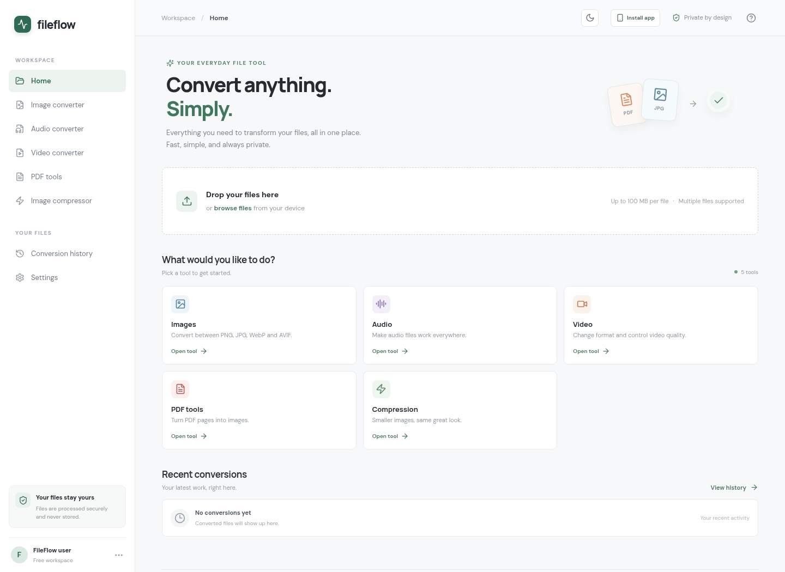

# FileFlow — Universal File Converter

FileFlow is a lightweight file conversion and compression app. Convert images, audio, video, and PDF pages through a responsive web interface, with batch processing and a downloadable conversion queue.

> Files are uploaded only when you start a conversion. Processing uses temporary server files; browser history stores metadata, not file contents.

## Screenshots



This screenshot was captured from the running production build. No conversion files or personal data are shown.

## Features

- [x] Convert and compress multiple files in one queue.
- [x] Track pending, processing, completed, failed, and cancelled jobs.
- [x] Set conversion presets and output quality, bitrate, or resolution where supported.
- [x] Compare original and compressed images with an interactive before-and-after slider.
- [x] Preview images, audio, video, and rendered PDF pages.
- [x] Download individual results or successful results as a ZIP.
- [x] View recent conversion metadata in browser history.
- [x] Use light or dark mode, keyboard shortcuts, and the installable PWA.
- [x] Keep the application shell available offline after it has been visited; conversions require the server.

## Supported formats

Input is classified by file content on the server as well as by the browser’s file picker. A format may still fail if the installed system converter does not include its decoder or encoder.

| Category | Supported input | Output |
| --- | --- | --- |
| Images | PNG, JPG/JPEG, WebP, AVIF | PNG, JPG/JPEG, WebP, AVIF |
| Image compression | PNG, JPG/JPEG, WebP, AVIF | PNG, JPG/JPEG, WebP |
| Audio | MP3, WAV, FLAC, AAC, Ogg, M4A/audio MP4 | MP3, WAV, FLAC |
| Video | MP4, WebM, MOV, MKV/Matroska, AVI | MP4, WebM, MOV |
| PDF tools | PDF | Each page as PNG or JPG, with page previews and downloads |

PDF output can be downloaded as an archive. Batch conversion keeps successful files if another file fails. Compression and media settings are applied by the conversion engines, not just stored as labels.

## Technology

- React 19 and TypeScript
- Vite and Tailwind CSS 4
- Express 5 and Multer
- ImageMagick 7 for image conversion
- FFmpeg and FFprobe for audio and video conversion
- Poppler (`pdfinfo`, `pdftoppm`) for PDF validation and rendering
- PDF.js for browser-side PDF metadata and previews
- JSZip for browser-side ZIP downloads

## Architecture

The browser application is a Vite-built React SPA. It sends same-origin multipart requests to the Express API only after the user starts conversion. Express validates the uploaded content and settings, writes the upload to a private per-process temporary directory, and runs the appropriate system converter without a shell. Converter output is size-limited and returned to the browser; temporary input and output files are removed after the request. Browser-side job results remain in memory for the current page session. Local storage contains only theme and conversion-history metadata.

The production Express process serves the built SPA and its static assets as well as the conversion API. There is no database or account service.

## Project structure

```text
FileFlow/
├── docs/screenshots/       # Real screenshots used in project documentation
├── public/                 # PWA manifest, service worker, and icons
├── src/
│   ├── main.tsx            # React application and queue workflows
│   ├── style.css           # Application styles
│   └── vite-env.d.ts       # Vite type declarations
├── server.ts               # Express API and conversion process management
├── index.html              # SPA entry document
├── vite.config.ts          # Vite plugins and development API proxy
├── tsconfig.json           # TypeScript configuration
├── package.json            # Scripts and dependencies
├── package-lock.json       # Locked npm dependency tree
├── CHANGELOG.md            # Release history
└── README.md
```

## Requirements

- Node.js 22.13 or later (Node.js 24 LTS recommended)
- npm
- FFmpeg and FFprobe on `PATH`
- ImageMagick 7 with AVIF support (`magick`)
- Poppler utilities (`pdfinfo` and `pdftoppm`)

On Debian or Ubuntu, the system packages can be installed with:

```sh
sudo apt-get update
sudo apt-get install -y ffmpeg imagemagick poppler-utils
```

Check `magick -list format` for AVIF read/write support. The exact codec support depends on the operating system packages used for deployment.

## Install and develop

```sh
git clone <YOUR_REPOSITORY_URL>
cd FileFlow
npm ci
npm run dev
```

Open <http://localhost:5173>. The `dev` script runs Vite and the Express API together. Vite proxies `/api` requests to port 3001. The development setup does not register the production service worker.

Useful scripts:

| Command | Purpose |
| --- | --- |
| `npm run dev` | Start the Vite UI and Express API for local development. |
| `npm run build` | Type-check the project and create the production Vite bundle in `dist/`. |
| `npm start` | Serve the production build and conversion API. Run `npm run build` first. |
| `npm run client` | Start Vite only. |
| `npm run server` | Start the Express API only. |

## Production deployment

Build and run the app as a long-lived Node.js service:

```sh
npm ci
npm run build
NODE_ENV=production \
PORT=3001 \
HOST=127.0.0.1 \
PUBLIC_ORIGIN=https://files.example.com \
TRUST_PROXY=1 \
FORCE_HTTPS=true \
npm start
```

Put the service behind an HTTPS reverse proxy and keep its Node port private. Configure the proxy to cap request bodies at 100 MB plus multipart overhead, overwrite forwarded headers, set an upstream read timeout above the media conversion timeout, and disable response buffering for `/api/convert/media` so progress events reach the browser. `TRUST_PROXY=1` is appropriate only when exactly one trusted proxy is in front of the app and it sanitizes forwarded headers. Do not set it to `true` on an app that is directly reachable from the internet.

Run FileFlow as a non-root user, preferably in a container or service with CPU, memory, process, and disk quotas. Use encrypted ephemeral storage for temporary files; never expose the temp directory through the web server. Graceful shutdown removes the app’s temp directory. If the process is killed abruptly, the next startup removes abandoned FileFlow temp directories; configure operating-system temporary-file cleanup as a backstop.

### Environment variables

| Variable | Default | Purpose |
| --- | --- | --- |
| `NODE_ENV` | unset | Set to `production` to enable production security and cache headers. |
| `PORT` | `3001` | HTTP listen port (1–65535). |
| `HOST` | `0.0.0.0` | Listen address; use `127.0.0.1` behind a local reverse proxy. |
| `PUBLIC_ORIGIN` | Derived from request | Canonical browser origin, e.g. `https://files.example.com`. Must use HTTPS in production; mismatched API `Origin` headers are rejected. |
| `TRUST_PROXY` | Disabled | Number of trusted proxy hops, such as `1`. `true` trusts all hops and should only be used behind a controlled proxy. |
| `FORCE_HTTPS` | `false` | Set to `true` to send HSTS when TLS terminates at a trusted proxy. |
| `MAX_CONCURRENT_CONVERSIONS` | `2` | Active server jobs (1–8). Excess jobs receive HTTP 429. |
| `CONVERSION_TIMEOUT_MS` | `600000` | Media conversion timeout (30 seconds–30 minutes). Image and PDF timeouts are 2 and 3 minutes. |

## Security and privacy

- Maximum upload size is 100 MB per file. Uploads are validated by content signatures and then inspected with the relevant converter; submitted extensions and MIME types are not trusted.
- Image input is limited to 40 megapixels. Audio is limited to 3 hours; video to 30 minutes and 4K input resolution. Media results are limited to 64 MB.
- PDFs are limited to 50 pages, 8 MB per rendered page, and 48 MB total rendered output.
- Conversion requests are limited to 20 per client IP per minute; all API requests are limited to 120 per client IP per minute. Limits and the two-job default are in process memory, so add shared edge limits before running multiple instances.
- The production API sends `Cache-Control: no-store`, applies security headers, rejects cross-origin browser API requests, and returns safe errors without converter paths or stack traces.
- The service worker caches the app shell and static assets only. It bypasses API requests and never caches uploads or conversion results.
- Browser local storage contains theme and history metadata only. Files and converted results are held in memory for the current session; history cannot restore downloads after that session ends.
- FileFlow does not include user authentication or malware scanning. Public deployments should be isolated, rate-limited, and resource-constrained. Keep FFmpeg, ImageMagick, Poppler, Node.js, and npm dependencies updated.

## Known limitations

- Conversion availability depends on the decoders and encoders compiled into the installed system tools; unsupported codecs and damaged files fail with an error.
- Limits intentionally exclude very large or long files. ZIP creation is capped at 100 MB and 30 files; the browser retains at most 250 MB of results per session.
- Conversion history stores metadata only. Results are not persisted or available after the current page session is gone.
- Rate limits and concurrency limits are local to one Node process. Multi-instance deployments need shared limits at the edge.
- A malware scanner and user authentication are not included. Treat uploaded files as untrusted and isolate the conversion service.
- A `LICENSE` file has not been selected. Choose and add a license before publishing the repository as open source.

## Deployment checklist

- [ ] Install current FFmpeg/FFprobe, ImageMagick with AVIF support, and Poppler packages.
- [ ] Run `npm ci`, `npm audit --omit=dev`, and `npm run build` in release CI.
- [ ] Run the service as non-root with CPU, memory, process, and disk limits.
- [ ] Configure HTTPS, `PUBLIC_ORIGIN`, trusted proxy headers, request size limits, and media response timeouts.
- [ ] Keep temporary storage private and ephemeral; confirm the reverse proxy does not log request bodies.
- [ ] Add shared edge rate limiting before using more than one app instance.
- [ ] Select and add a `LICENSE` before describing the project as open source.
- [ ] Review the GitHub repository description and topics before making the repository public.

## Release and security checks

```sh
npm run build
npm audit --omit=dev
```

The build runs TypeScript checking and the production Vite build. `npm audit` needs registry access; also monitor the operating-system converter packages separately.
